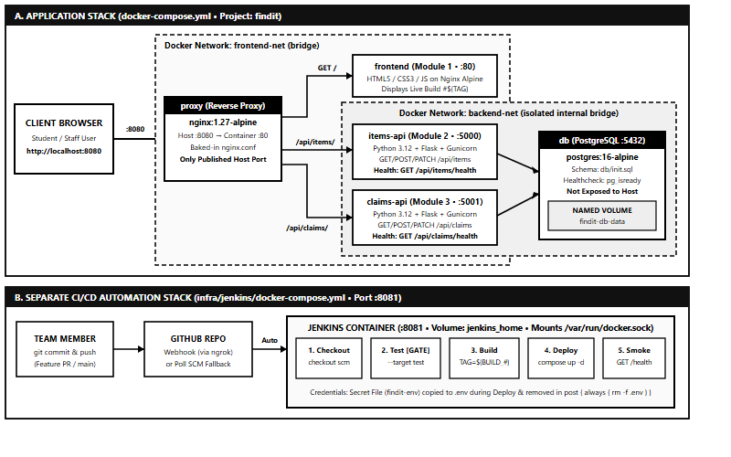

# FindIt — Campus Lost & Found Management System

> **System Architecture and Integration (SYSIN) Final Project**  
> **Course & Section:** ITE-305 | **Academic Year 2026**  
> **Containerized Infrastructure and CI/CD Automation using Docker and Jenkins**

**FindIt** is a containerized multi-module web application designed for campus communities to report lost belongings, post found items, search and filter active listings, and submit or review item recovery claims. Once a claim is approved by staff, the corresponding item's status is automatically updated to `returned`.

---

## 1. System Architecture



### Container & Module Overview

| Container | Type | Technology Stack | Internal Port | Host Port | Network(s) | Purpose |
| :--- | :--- | :--- | :--- | :--- | :--- | :--- |
| **`proxy`** | Reverse Proxy | `nginx:1.27-alpine` | `80` | **`8080`** | `frontend-net` | Single public entry point; routes `/`, `/api/items/`, and `/api/claims/`. |
| **`frontend`** | App Module 1 | HTML5, CSS3, ES6 JS (`nginx:1.27-alpine`) | `80` | *None* | `frontend-net` | User interface for reporting items, browsing/filtering, submitting claims, and displaying live `Build #`. |
| **`items-api`** | App Module 2 | Python 3.12 + Flask + Gunicorn (`python:3.12-slim`) | `5000` | *None* | `frontend-net`, `backend-net` | REST microservice for lost/found item CRUD and `GET /api/items/health`. |
| **`claims-api`** | App Module 3 | Python 3.12 + Flask + Gunicorn (`python:3.12-slim`) | `5001` | *None* | `frontend-net`, `backend-net` | REST microservice for claim submission, approval/rejection, status updates, and `GET /api/claims/health`. |
| **`db`** | Database | PostgreSQL 16 (`postgres:16-alpine`) | `5432` | *None* | `backend-net` | Persistent relational storage (`items` and `claims` tables) using named volume `findit-db-data`. |
| **`jenkins`** | CI/CD Server | `jenkins/jenkins:lts-jdk17` + Docker CLI | `8080` | **`8081`** | Separate Compose | Automated CI/CD pipeline server with persistent `jenkins_home` volume. |

---

## 2. Team Members & Roles

| Member | Primary Role | Key Deliverables & Owned Paths |
| :--- | :--- | :--- |
| **Joshua Andrei Lunca** | Project Lead / Scrum Master | Phase 1 Project Proposal, `docs/architecture.png`, Presentation Slides, Git coordination |
| **Dominic Marasigan** | Frontend & Docker Infrastructure Lead | `frontend/` (`index.html`, `admin.html`, `css/`, `js/`), `docker-compose.yml`, multi-stage `Dockerfile`s, `proxy/` |
| **Rey Fritz Eisen Tan** | Backend & Database Engineer | `db/init.sql`, `items-api/` (`app.py`, `tests/`), `claims-api/` (`app.py`, `tests/`) |
| **Charles Kennedy Lawingco** | DevOps / CI-CD Engineer | Root `Jenkinsfile`, `infra/jenkins/Dockerfile`, `infra/jenkins/docker-compose.yml`, rollback procedures |
| **Kim Carlo Abarientos** | QA Automation & Technical Documentation Lead | `scripts/smoke-test.sh`, `docs/TECHNICAL_DOCUMENTATION.md`, smoke test verification runbook |

---

## 3. Repository Structure

```text
findit/
├── Jenkinsfile                  # Declarative 5-stage CI/CD pipeline as code
├── docker-compose.yml           # Application stack orchestration
├── .env.example                 # Placeholder environment variables (committed)
├── .gitignore                   # Excludes .env, Python caches, etc.
├── README.md                    # Project overview and setup instructions
├── docs/
│   ├── architecture.png         # System architecture diagram
│   ├── architecture.svg         # Vector architecture diagram
│   └── TECHNICAL_DOCUMENTATION.md # Comprehensive system documentation & runbook
├── scripts/
│   └── smoke-test.sh            # Automated post-deployment smoke test script
├── proxy/
│   ├── Dockerfile               # Bakes nginx.conf into nginx:1.27-alpine
│   └── nginx.conf               # Reverse proxy routing rules
├── frontend/
│   ├── Dockerfile               # Injects BUILD_NUMBER into static UI
│   ├── .dockerignore
│   ├── index.html               # Public Student Portal
│   ├── admin.html               # Restricted ITSO Staff Console
│   ├── css/
│   │   └── styles.css
│   └── js/
│       └── app.js
├── items-api/
│   ├── Dockerfile               # Multi-stage: base -> test -> production
│   ├── .dockerignore
│   ├── requirements.txt
│   ├── app.py
│   └── tests/
│       └── test_items.py
├── claims-api/
│   ├── Dockerfile               # Multi-stage: base -> test -> production
│   ├── .dockerignore
│   ├── requirements.txt
│   ├── app.py
│   └── tests/
│       └── test_claims.py
├── db/
│   └── init.sql                 # PostgreSQL schema + initial campus seed data
└── infra/
    └── jenkins/
        ├── Dockerfile           # Jenkins LTS + Docker CLI + Compose plugin
        └── docker-compose.yml   # Separate Jenkins stack on port 8081
```

---

## 4. Quick Start (Local Development)

1. **Clone the repository:**
   ```bash
   git clone https://github.com/dgmdev-sql/findit.git
   cd findit
   ```
2. **Create your local `.env` file from the template:**
   ```bash
   cp .env.example .env
   ```
3. **Run multi-stage unit tests inside Docker:**
   ```bash
   docker build --target test -t findit/items-api:test ./items-api
   docker build --target test -t findit/claims-api:test ./claims-api
   ```
4. **Start the complete application stack:**
   ```bash
   docker compose up -d --build
   ```
5. **Open the application in your browser:**
   - Student Portal (via Nginx Proxy): [http://localhost:8080](http://localhost:8080)
   - ITSO Admin Console: [http://localhost:8080/admin.html](http://localhost:8080/admin.html)
   - Items API Health Check: [http://localhost:8080/api/items/health](http://localhost:8080/api/items/health)
   - Claims API Health Check: [http://localhost:8080/api/claims/health](http://localhost:8080/api/claims/health)

---

## 5. Starting Jenkins CI/CD (`infra/jenkins/`)

1. **Start the separate Jenkins container:**
   ```bash
   cd infra/jenkins
   docker compose up -d --build
   ```
2. **Retrieve the initial admin password:**
   ```bash
   docker exec jenkins cat /var/jenkins_home/secrets/initialAdminPassword
   ```
3. **Open Jenkins at [http://localhost:8081](http://localhost:8081):**
   - Install suggested plugins + **Docker Pipeline**.
   - Add your `.env` file in **Manage Jenkins → Credentials** as a **Secret file** with ID: `findit-env`.
   - Create a Pipeline job pointing to this repository (`Script Path: Jenkinsfile`).
4. **Rollback Command:**
   ```bash
   TAG=<previous-build-number> docker compose -p findit up -d --no-build
   ```
